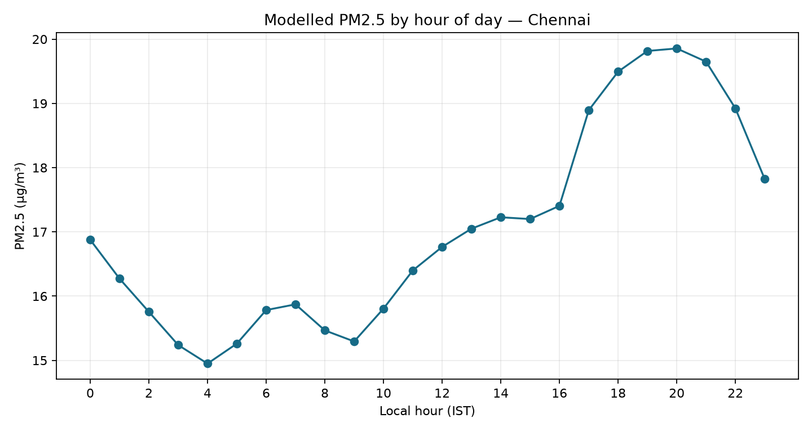
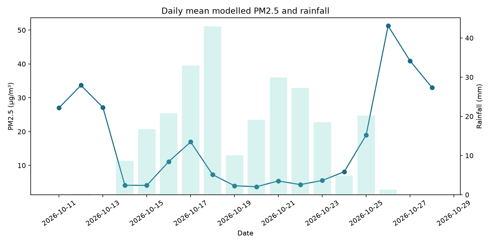

# Findings: Chennai air quality, hour by hour

## Sample and provenance

- Coverage: **2026-10-11 00:00** to **2026-10-28 23:00 IST**, 432 hourly timestamps.
- Requested coordinates: **13.0827° N, 80.2707° E**; the returned model grid coordinates are preserved in `data/chennai_hourly.csv`.
- PM2.5 is a gridded CAMS model estimate served through Open-Meteo, not a station reading. Weather is Open-Meteo historical reanalysis.

## Findings

1. **Hour-of-day pattern:** highest hourly mean was at **20:00 IST** (19.86 µg/m³). Commute windows (07:00–09:59 and 17:00–19:59) averaged **17.47 µg/m³** (median 10.15) versus **16.90 µg/m³** at other hours.
2. **Rain comparison:** rain hours averaged **9.70 µg/m³** across 235 hours and dry hours averaged **25.80 µg/m³** across 197 hours. Hours immediately before a rainy next hour averaged **9.62 µg/m³** versus **25.90 µg/m³** otherwise. These are descriptive associations, not evidence that rain caused a change.
3. **Sunday:** mean of hourly PM2.5 averages was **17.77 µg/m³** on Sundays and **16.90 µg/m³** Monday–Saturday. Interpret cautiously with this short sample.

## Caveats

Open-Meteo documents the global CAMS air-quality product at roughly 45 km and 3-hour native resolution; hourly output does not imply local sensor precision. This is not ground-truth monitoring. Weather rain is gridded reanalysis, not a gauge observation. Commute-hour comparisons do not measure traffic volume, and rain associations do not establish causality. The small date range cannot establish a seasonal pattern.

## Charts

