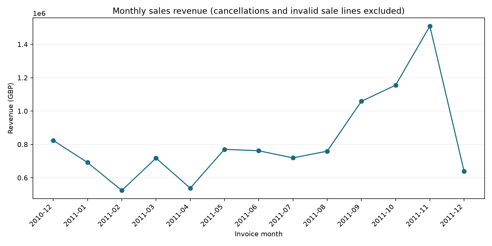
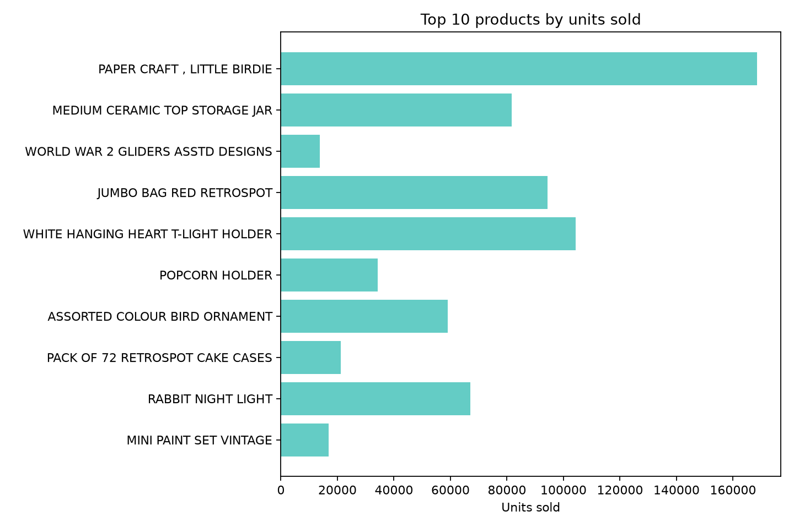

# Findings: Online Retail

## Dataset and cleaning

- Source lines: **541,909**; sale lines retained: **530,104**.
- Distinct invoices: **25,900**; cancellation invoices: **3,836** (**14.81%**).
- Exact duplicate rows flagged for review (not automatically removed): **5,268**.
- Revenue definition: quantity × unit price for non-cancellation rows with positive quantity and price, in GBP.
- Total analyzed sales revenue: **10,666,684.54 GBP**.

## Findings

1. **November 2011 revenue:** 1,509,496.33 GBP; change from October: **30.7%**. December is partial and should not be compared as a full month.
2. **Top item by units:** PAPER CRAFT , LITTLE BIRDIE (80,995 units). The revenue leader is DOTCOM POSTAGE (206,248.77 GBP), which is a postage line rather than a gift item.
3. **Top non-UK market:** Netherlands by revenue, excluding the UK.

## Interpretation limits

Cancellation share is invoice-based, not value-based. The revenue metric excludes cancellation invoices and nonpositive quantities/prices; it is not a complete accounting net-sales measure. Missing customer IDs remain in the transaction totals. December 2011 ends on 9 December. Exact duplicate-looking rows are flagged for review but retained because repeated identical items can be legitimate purchases.

## Charts

