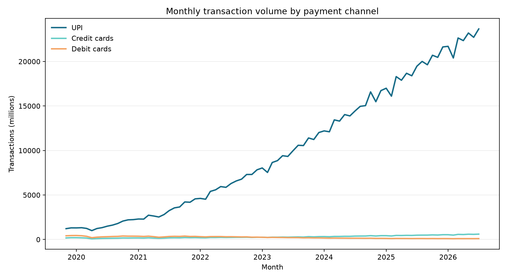
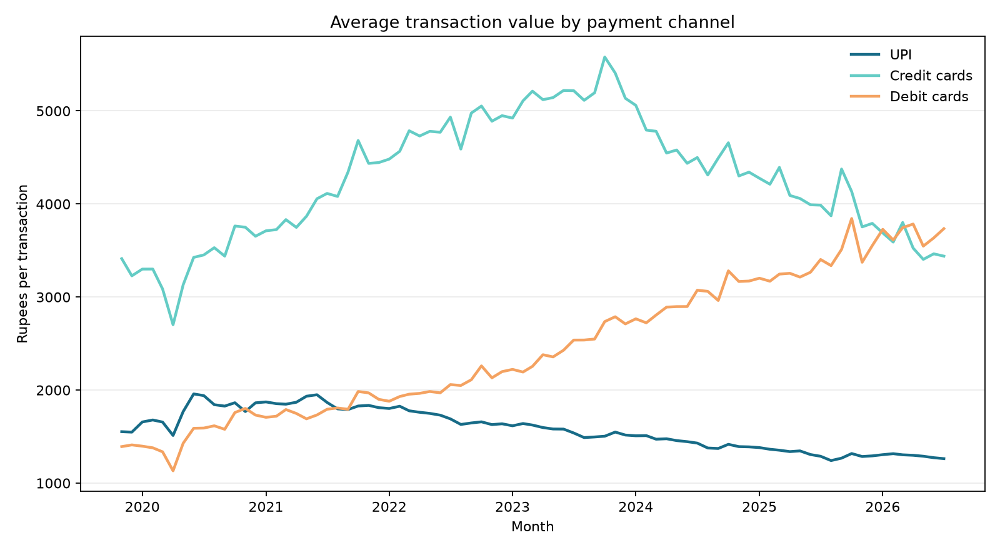

# Findings: UPI and cards

## Coverage and units

- RBI DBIE monthly observations: **81**, from **November 2019** through **July 2026**.
- Reported volume is normalized from lakh transactions to millions; reported value is ₹ crore.
- Average transaction value = value (₹ crore) × 100 / volume (lakh).

## Findings

1. **UPI scale:** monthly UPI volume rose from **1,218.8 million** to **23,658.4 million**, about **19.4×** over 80 months. Latest year-over-year growth was **21.5%**.
2. **Card comparison:** in July 2026, credit-card transaction volume was **605.3 million** and debit-card volume was **101.6 million**. Their latest year-over-year changes were **24.5%** and **-9.4%**, respectively.
3. **Ticket size:** latest average UPI transaction value was **₹1,263** versus **₹1,553** in November 2019. Compared with July 2025, UPI volume changed 21.5% and UPI value changed 19.1%.
4. **Channel mix:** UPI was **97.1%** of the combined UPI, credit-card, and debit-card transaction count in the latest month. This denominator covers these three channels only.

## Interpretation

UPI grew rapidly while card usage remained a distinct and sizeable channel. Aggregate trends cannot show that UPI directly replaced card payments: the RBI series combine different transaction types and uses. The UPI share metric is a limited three-channel comparison, not a share of every payment in India.

## Data cautions

RBI notes that card statistics from November 2019 onward use more granular definitions and may not be comparable with earlier data; the analysis begins in that month. Figures are provisional. The latest RBI DBIE table observation may lag the newest NPCI UPI monthly release.

## Charts

