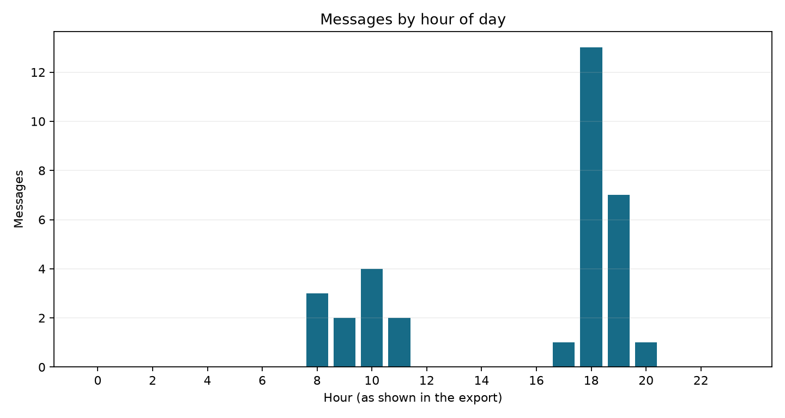
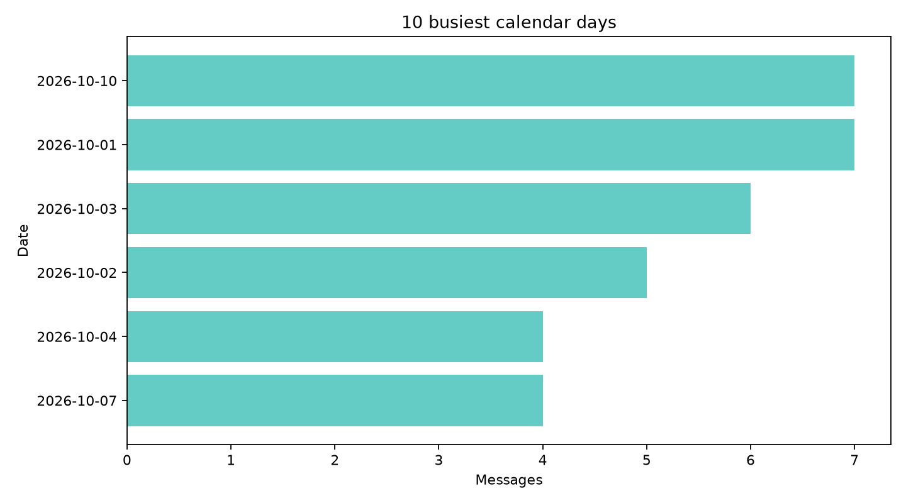

# Findings: WhatsApp group chat

## Demonstration data notice

This report uses a **synthetic example chat** created for the project. Participant labels and messages are invented; these results do not describe a real WhatsApp group. Replace the sample with your own private export to produce personal findings, and do not publish identifiable results.

## Sample

- Parsed participant messages: **33** across **4** participants.
- Date span: **2026-10-01 18:03:00** to **2026-10-10 19:11:00**.
- Lines with a timestamp but an unsupported date/time format: **0**.
- Messages included in word and emoji counts: **33**.

## Activity

- Most active participant: **Participant A** (9 messages).
- Busiest hour: **18:00** (13 messages).
- Busiest calendar day: **2026-10-01** (7 messages).
- Approximate participant hand-offs within 60 minutes: **26**. This is not a count of direct replies; WhatsApp export text has no reply/thread links.

## Language and emoji

- Frequent words are in `top_words.csv`; emoji counts are in `top_emojis.csv`. The editable stop-word list in `src/analyze.py` is only a starter and may miss Tamil forms, transliterations, names, slang, or context-specific filler words.

## Privacy and limits

This report contains aggregate activity metrics. Participant names can still identify people; anonymize before sharing. The input export is not copied to reports and the script does not transmit it.

## Charts

