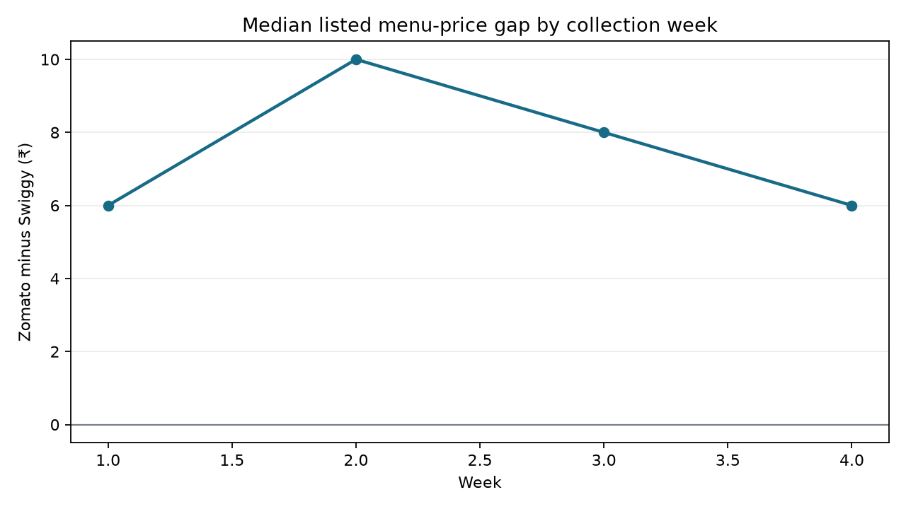

# Findings: Zomato vs Swiggy price gap

## Demonstration data notice

This report uses **synthetic demonstration values** and invented restaurant labels. No prices were observed in either app, and the figures do not support a claim about Zomato or Swiggy. Replace the demo with your own manually recorded, same-time observations before drawing conclusions.

## Sample and coverage

- Observations: **40**; paired restaurant/dish/week/date sets: **20**.
- Coverage: **2026-09-02 to 2026-09-27**.
- Complete app pairs: **20**; unmatched or duplicate keys are in `pairing_coverage.csv`.

## Findings

1. **Listed menu price:** median paired gap (Zomato minus Swiggy) was **₹8.00**. Zomato listed a higher price in **100.0%** of pairs.
2. **Observed pre-tax total:** median paired gap was **₹18.50**, including delivery and packaging fees where all three inputs were recorded.
3. **App summaries:** see `summary_by_app.csv` for median observed menu prices, fees, and ratings. Rating differences should be interpreted cautiously because the apps may display ratings on different scales or populations.

## Method limits

Only same-date, same-week, same-restaurant, same-standardized-dish observations with one row per app are paired. Missing delivery/packaging fees are not imputed as zero. The sample is manually collected and may be affected by timing, delivery location, app promotions, and account status. This is not a causal test or a population-wide comparison.

## Chart

